<picture>
  <source media="(prefers-color-scheme: dark)" srcset="assets/header-dark.svg">
  
</picture>

[LinkedIn](https://linkedin.com/in/mohit-nilvarn-568319249/) &nbsp;·&nbsp; [Kaggle](https://kaggle.com/mohit17084) &nbsp;·&nbsp; [Email](mailto:mohitnils1708@gmail.com) &nbsp;·&nbsp; Pune, India

 

### About

I'm an AI/ML engineer at ImmersiveData.ai and a Google Cloud Certified Professional Data Engineer. I build end-to-end data and ML pipelines in Python and SQL, from ingestion and data quality through feature engineering, modeling, and risk scoring, on Spark, Databricks, and Google Cloud.

Recent work spans credit-risk prediction, anomaly detection on high-volume meter data, document AI for identity verification, and LLM agents that complete real tasks through tool calling.

I like problems where the data is messy and the answer isn't a clean yes or no. That's usually where the more useful models come from.

 

### Experience

**AI/ML Engineer** &nbsp;·&nbsp; ImmersiveData.ai &nbsp;·&nbsp; *Aug 2026 – present, promoted from intern*
- Built an end-to-end pipeline predicting EMI bounce (missed-payment) risk for an NBFC: ingestion and integration of customer and repayment data, validation, feature engineering, training, and risk scoring.
- Built electricity theft detection from meter tampering, engineering consumption-anomaly features over meter data to flag suspected cases.
- Built an autonomous LLM agent that books cabs from user preferences, using tool calling to complete rides without manual steps.

**AI/ML Intern** &nbsp;·&nbsp; ImmersiveData.ai &nbsp;·&nbsp; *Nov 2025 – Aug 2026*
- Built OCR-based KYC identity verification on Google Vertex AI Vision, cutting manual review time by ~35%.
- Built real-time speech-to-text systems, and prototyped a LangChain RAG chatbot behind FastAPI that lets non-technical users query business data in plain English.
- Instrumented AI services with Langfuse and Grafana for tracing, monitoring, and evaluation.

**AI/ML Intern** &nbsp;·&nbsp; AppSynergies &nbsp;·&nbsp; *Sep 2025 – Nov 2025, remote*
- Designed n8n lead-handling automations with CRM data synced to Supabase, and a LangChain proposal generator that cut turnaround time by ~40%.

 

### Selected projects

**Teacher Assistance Platform** &nbsp;·&nbsp; [repository](https://github.com/MohitNilvarn/Teachers-Assistance-Platform) 
Lecture recordings in, study material out. ASR, transformer summarization, and a RAG pipeline over open-weight LLMs generate transcripts, notes, assignments, and flashcards, reducing manual content prep by ~50%.

**RAG research assistant** 
Document ingestion and indexing with Hugging Face embeddings and FAISS, with tool routing that falls back to Wikipedia when retrieval confidence is low. Reaches 85%+ semantic relevance.

**Recommendation engine** 
A similarity-based movie recommender that combines collaborative filtering with Naive Bayes and logistic regression, reaching 88% accuracy with cross-validation and tuning.

**Applied computer vision** 
Vegetation index extraction and land segmentation from satellite and aerial imagery for agricultural use cases.

 

### Currently exploring

Spending evenings on probabilistic deep learning: variational inference, MC dropout, deep ensembles. The goal is models that can say "I'm not sure" instead of guessing confidently and being wrong.

 

### Toolkit

| Area | Tools |
|:---|:---|
| **Languages** | Python · SQL · C++ · Java · Bash |
| **Data engineering** | Apache Spark (PySpark) · Databricks · Hadoop (HDFS) · BigQuery · Dataproc · Bigtable |
| **Machine learning** | scikit-learn · XGBoost · PyTorch · TensorFlow · Pandas · Matplotlib |
| **Generative AI** | LangChain · LLM agents · RAG · Hugging Face · OCR · Langfuse |
| **Databases** | PostgreSQL (Supabase) · MongoDB Atlas · NoSQL stores · FAISS |
| **Cloud** | Google Cloud (Vertex AI, Vision AI) · AWS · Azure |
| **Engineering** | FastAPI · Flask · Docker · Kubernetes · CI/CD · MLflow · DVC · Grafana · Linux · Git |

 

### Credentials

[Google Cloud Certified Professional Data Engineer](https://www.credly.com/badges/2983cd4f-212d-4c1f-9b9d-4ba92fa78085/public_url) 
[Oracle Cloud Infrastructure 2025 Generative AI Professional](https://brm-certview.oracle.com/ords/certview/ecertificate?ssn=OC6895666&trackId=OCI25GAIOCP&key=e725373ed1828469426f69af299651ee5fb72fa2)

B.E. in Electronics & Telecommunication Engineering with Honours in AI & ML, Trinity Academy of Engineering, Pune, 2026.

 

### Activity

<picture>
  <source media="(prefers-color-scheme: dark)" srcset="https://raw.githubusercontent.com/MohitNilvarn/MohitNilvarn/output/github-contribution-grid-snake-dark.svg">
  
</picture>
